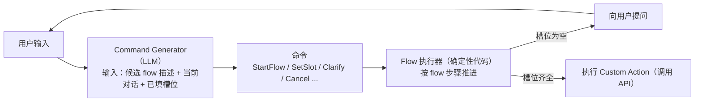
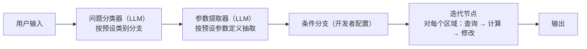
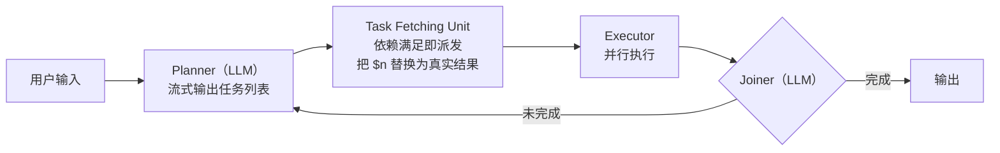
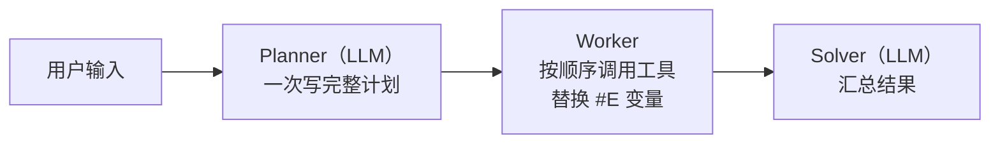
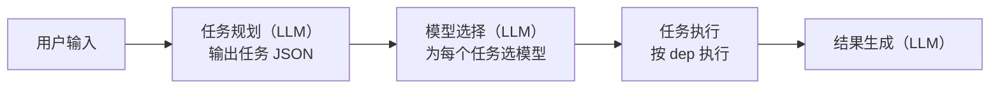
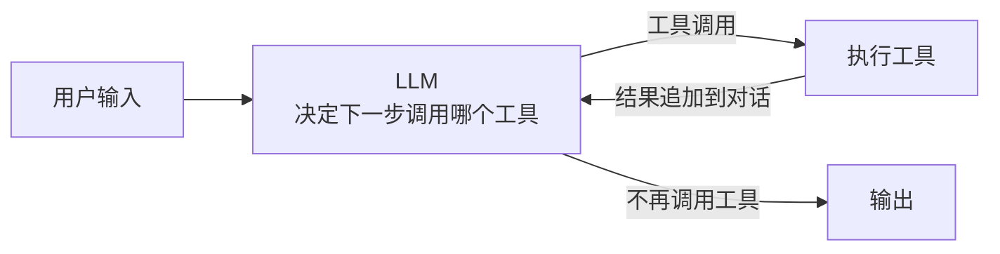
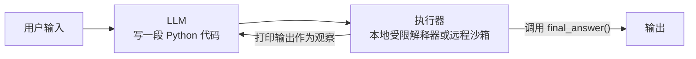

# 开源项目如何把自然语言转为可执行任务：调研

## 1. 调研目标

调研开源项目如何把一句自然语言（NL）转成一组可执行的 API 调用，重点看它们如何处理三个关键点：

| 关键点 | 含义 |
|---|---|
| ① 拆步骤 | 从 NL 中确定要执行哪几个步骤 |
| ② 定顺序 | 确定步骤之间的先后与依赖 |
| ③ 补参数 | 确定每个步骤的参数值从哪来，缺了怎么办 |

统一示例：**“把 Plot_1 中 A、B、C 三个区域的权重都乘以 2”**。要完成它，需要先查询三个区域的当前权重，再分别修改。

---

## 2. 结论速览

调研的项目按“步骤由谁决定、何时确定”可分为四类：

| 类别 | 代表项目 | ① 拆步骤 | ② 定顺序 | ③ 补参数 |
|---|---|---|---|---|
| **A. 预定义流程** | Rasa CALM、Dify | 开发者预先编写流程；LLM 只负责选择流程 | 写死在流程中 | LLM 从原话中抽取；缺参时，Rasa 自动追问，Dify 需开发者自行设计 |
| **B. 一次性规划** | LLMCompiler、ReWOO、HuggingGPT | LLM 在执行前一次性生成全部步骤 | 计划中用变量引用表达依赖（`$1`、`#E1`、`<resource>-1`） | 已知值由 LLM 直接写入；前序结果用变量占位，执行时替换；无追问机制 |
| **C. 逐步决策** | ReAct、各家模型的 Function Calling | LLM 每轮只决定下一步 | 生成的先后即顺序，事先不存在完整计划 | LLM 看到上一步的真实结果后再填写 |
| **D. 代码即行动** | smolagents、TaskWeaver | LLM 写代码，步骤即代码中的函数调用 | 代码语句顺序与循环 | 通过代码变量传递 |

另有一类**专用工具调用模型**（如 Gorilla），它不是流程框架，而是可替换上述各类中 LLM 的模型组件。

---

## 3. 各项目逻辑

### 3.1 A 类：预定义流程

#### Rasa CALM

定位：企业级对话机器人引擎。业务逻辑由开发者写成流程（flow），LLM 只负责理解用户的话。



- **① 拆步骤**：不由 LLM 拆分。LLM 输出 `StartFlow(某流程)` 来选择流程，步骤由该流程定义；flow 很多时，先用向量检索筛出相关 flow，再放入提示词。
- **② 定顺序**：flow 中的步骤顺序加 `next` 条件分支，由执行器按序推进。
- **③ 补参数**：LLM 用 `SetSlot` 从用户的话中填槽；流程走到 `collect` 步骤时，若槽位为空，就自动向用户提问。用户表达有多种可能时，LLM 输出 `Clarify` 并列出候选流程。

示例（需预先定义 `scale_region_weights` 流程，循环与计算写在 Custom Action 里）：

```text
StartFlow(scale_region_weights)
SetSlot(plot_name, Plot_1)
SetSlot(region_names, [A, B, C])
SetSlot(factor, 2)
```

#### Dify

定位：可视化 LLM 应用平台，开发者在画布上用节点搭建工作流。



- **① 拆步骤**：开发者在画布上画出所有节点；运行时由“问题分类器”节点选择走哪条分支。
- **② 定顺序**：画布连线决定顺序；循环用迭代节点实现。
- **③ 补参数**：“参数提取器”节点按开发者定义的参数（名称、类型、描述、是否必填）用 LLM 抽取，并输出 `__is_success`、`__reason` 两个状态。参数缺失时，平台不会自动追问，需开发者用条件分支和回复节点自行设计。

示例（参数提取器的输出）：

```json
{"plot_name": "Plot_1", "region_names": ["A", "B", "C"], "factor": 2, "__is_success": 1}
```

> A 类内部的区别：Rasa CALM 是对话引擎，内置缺参追问、改口、取消等对话管理能力；Dify 是通用工作流平台，这些对话逻辑需开发者自己搭建。

---

### 3.2 B 类：一次性规划

#### LLMCompiler（UC Berkeley，ICML 2024）

定位：让 LLM 一次性生成带依赖关系的函数调用计划，并行执行。



- **① 拆步骤**：Planner 一次性输出全部任务，每个任务带编号。
- **② 定顺序**：任务参数中用 `$编号` 引用其他任务的结果，系统据此得到依赖图（DAG）；没有依赖的任务并行执行。
- **③ 补参数**：用户给出的值由 Planner 直接写入；依赖前序结果的参数写成 `$n`，执行时替换为真实值。没有缺参追问机制。Joiner 判断结果不足时会触发重新规划。

示例（论文中的计算需要专门的 `math` 工具）：

```text
1. get_weight("Plot_1", "A")
2. get_weight("Plot_1", "B")
3. get_weight("Plot_1", "C")
4. math("$1 * 2")
5. math("$2 * 2")
6. math("$3 * 2")
7. set_weight("Plot_1", "A", $4)
8. set_weight("Plot_1", "B", $5)
9. set_weight("Plot_1", "C", $6)
10. join()
```

#### ReWOO（2023）

定位：规划与执行彻底分离，整个过程只调用两次 LLM。



- **① 拆步骤**：Planner 一次写出全部步骤。
- **② 定顺序**：按计划书写顺序依次执行；用 `#E1`、`#E2` 表示依赖。不并行，也不重新规划。
- **③ 补参数**：同 LLMCompiler，用 `#En` 占位前序结果；无追问。

示例：

```text
Plan: 查询 A 的当前权重
#E1 = GetWeight[Plot_1, A]
Plan: 计算新权重
#E2 = Calculator[#E1 * 2]
Plan: 修改 A 的权重
#E3 = SetWeight[Plot_1, A, #E2]
...（B、C 同理）
```

#### HuggingGPT（微软，NeurIPS 2023）

定位：用 LLM 拆解任务，再调度 Hugging Face 上的 AI 模型执行。仓库为 `microsoft/JARVIS`。



- **① 拆步骤**：LLM 参照示例，把请求解析为任务 JSON 列表。
- **② 定顺序**：每个任务的 `dep` 字段列出它依赖的任务编号（`-1` 表示无依赖）；无依赖的任务可并行。
- **③ 补参数**：`args` 由 LLM 填写；需要前序结果时写 `<resource>-任务编号`。无追问。

示例（只列 A）：

```json
[
  {"task": "get_weight", "id": 0, "dep": [-1], "args": {"plot": "Plot_1", "region": "A"}},
  {"task": "multiply", "id": 1, "dep": [0], "args": {"value": "<resource>-0", "factor": 2}},
  {"task": "set_weight", "id": 2, "dep": [1], "args": {"plot": "Plot_1", "region": "A", "weight": "<resource>-1"}}
]
```

> B 类内部的区别：只在执行细节上。LLMCompiler 并行执行，并可重新规划；ReWOO 顺序执行，不重新规划，最省 token；HuggingGPT 多了“模型选择”阶段，面向的是 AI 模型调度而非业务 API。三者都是研究项目。

---

### 3.3 C 类：逐步决策

#### ReAct / Function Calling 循环

定位：ReAct 是一篇提出“推理 + 行动交替进行”的论文（ICLR 2023）。目前 OpenAI、Anthropic、Qwen 等模型的 Function Calling 多轮调用，以及 LangGraph 预置的 ReAct Agent，都是这一逻辑。



- **① 拆步骤**：没有事先的计划，LLM 每轮只输出下一步（新版 Function Calling 一轮可同时输出多个互不依赖的调用）。
- **② 定顺序**：生成的先后即执行顺序。
- **③ 补参数**：LLM 看到上一步的真实返回值后再填写参数，计算也由 LLM 自己完成。缺信息时，LLM 可以用文本向用户提问，但是否提问取决于模型本身。

示例：

```text
第 1 轮  LLM → get_weight(Plot_1, A), get_weight(Plot_1, B), get_weight(Plot_1, C)
         结果 → 0.4, 0.3, 0.2
第 2 轮  LLM → set_weight(Plot_1, A, 0.8), set_weight(Plot_1, B, 0.6), set_weight(Plot_1, C, 0.4)
第 3 轮  LLM → “已完成”
```

---

### 3.4 D 类：代码即行动

#### smolagents CodeAgent（Hugging Face）

定位：轻量 Agent 库。LLM 每一步写一段 Python 代码作为“行动”。



- **① 拆步骤**：步骤写在代码里，一段代码可以包含多次工具调用；仍是多轮循环，每轮写一段代码。可设置每隔 N 步插入一次规划。
- **② 定顺序**：代码语句顺序，以及 `for` 循环、`if` 判断。
- **③ 补参数**：通过代码变量传递，计算由代码完成。内置 `UserInputTool`，LLM 可在代码中调用它向用户提问。
- 工具定义：带类型注解和 docstring 的 Python 函数。

示例：

```python
for region in ["A", "B", "C"]:
    w = get_weight("Plot_1", region)
    set_weight("Plot_1", region, w * 2)
final_answer("done")
```

#### TaskWeaver（微软，已归档）

逻辑与 smolagents 相同，额外多了一个 Planner 角色：Planner（LLM）先把请求拆成子任务并与用户沟通，再由 Code Interpreter 为每个子任务生成调用插件的代码，在有状态的环境中执行。插件 = Python 函数 + YAML 参数描述。

> D 类内部的区别：smolagents 是单个 Agent 直接写代码；TaskWeaver 先由 Planner 拆子任务，再逐个写代码。

---

### 3.5 组件：专用工具调用模型

#### Gorilla / OpenFunctions（UC Berkeley）

定位：专门训练过 API 调用的模型，并配套函数调用评测榜 BFCL。同类模型还有 Salesforce xLAM、ToolACE 等。

- **逻辑**：输入“用户的话 + 所有函数的 JSON 定义”，模型直接输出函数调用 JSON，一次可输出多个调用。
- **① 拆步骤**：一次输出要调用的一个或多个函数。
- **② 定顺序**：输出格式中无法表达依赖。有依赖的多步任务，需要应用层多轮调用（即套用 C 类的循环）。
- **③ 补参数**：从用户的话中抽取；BFCL 会评测“没有合适函数时是否拒绝调用”，但对缺参情况没有追问机制。

---

## 4. 项目信息

数据截至 2026-11-13，来源为各 GitHub 仓库。

| 项目 | 仓库 | 许可 | Stars | 状态 |
|---|---|---|---|---|
| Rasa CALM | rasa.com（Rasa Pro） | 商业（有免费开发者版） | — | 持续迭代；开源版 `RasaHQ/rasa` 已进入维护模式 |
| Dify | langgenius/dify | Dify 开源许可 | 约 161k | 活跃 |
| LLMCompiler | SqueezeAILab/LLMCompiler | MIT | 约 1.9k | 2024 年 7 月后停更 |
| ReWOO | billxbf/ReWOO | MIT | 约 0.9k | 2023 年后停更 |
| HuggingGPT | microsoft/JARVIS | MIT | 约 25.6k | 研究项目，更新很少 |
| ReAct | ysymyth/ReAct | MIT | 约 4.3k | 论文代码 |
| LangGraph（含 ReAct Agent 实现） | langchain-ai/langgraph | MIT | 约 45k | 活跃 |
| smolagents | huggingface/smolagents | Apache-2.0 | 约 30k | 活跃 |
| TaskWeaver | microsoft/TaskWeaver | MIT | 约 6.2k | 已归档 |
| Gorilla | ShishirPatil/gorilla | Apache-2.0 | 约 13k | 活跃 |
