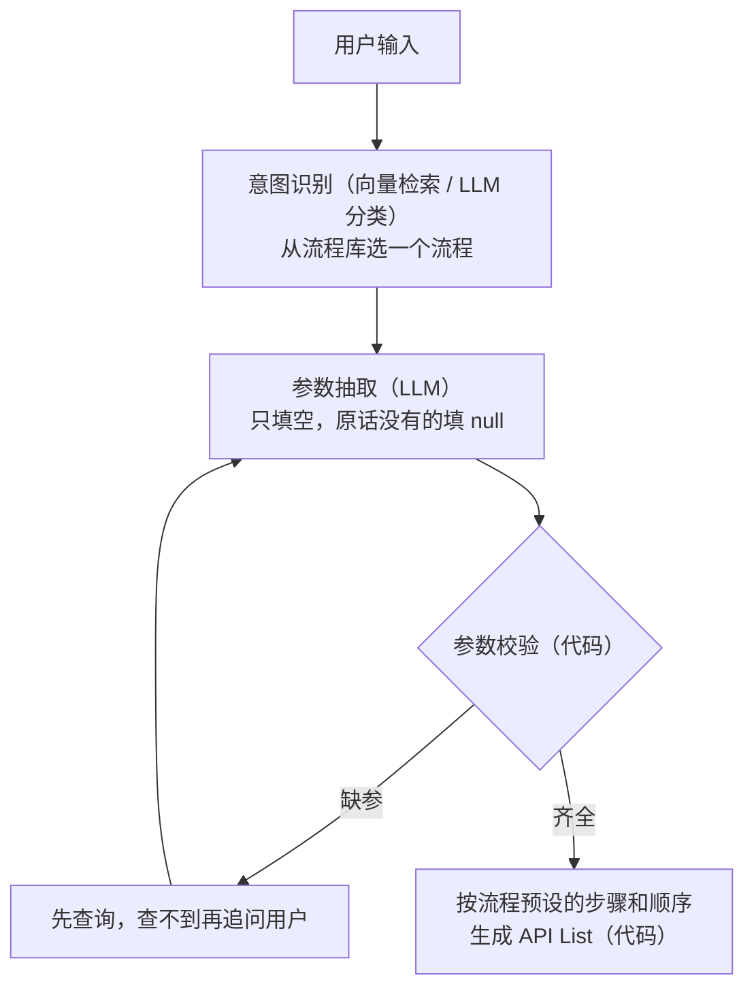
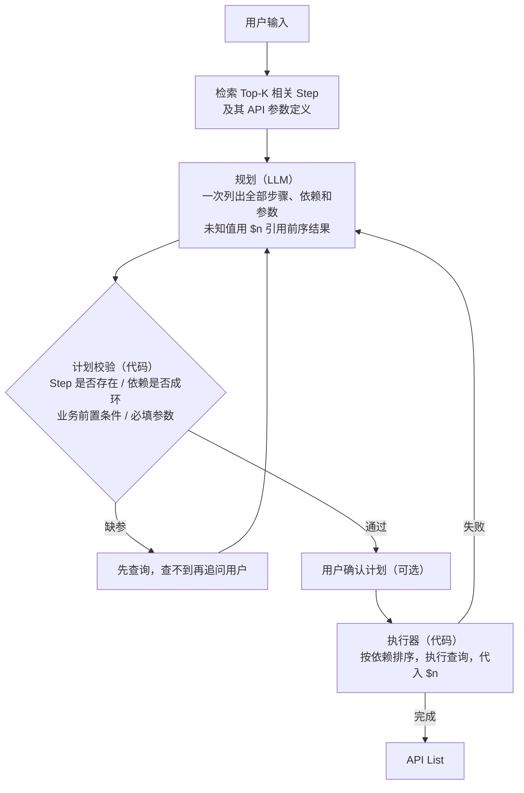
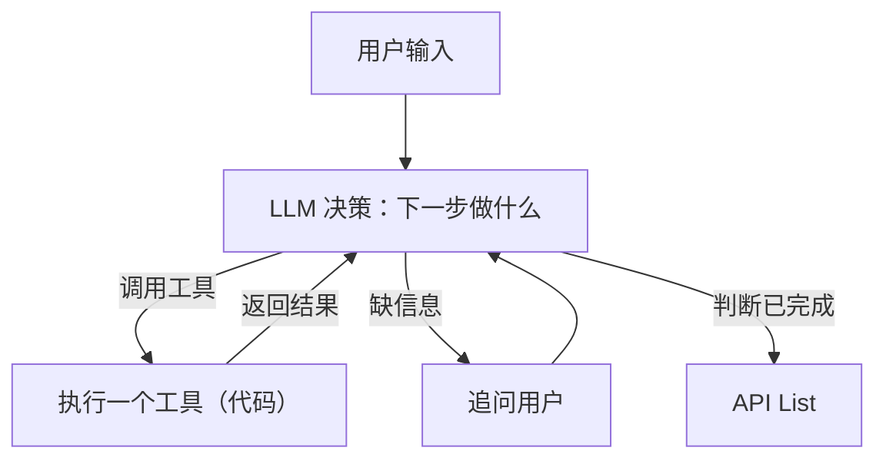
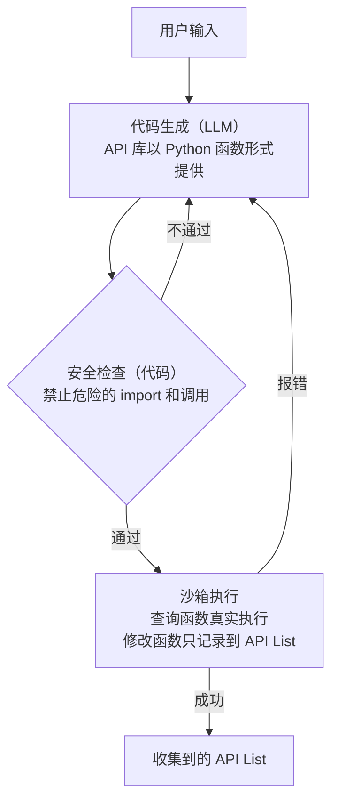
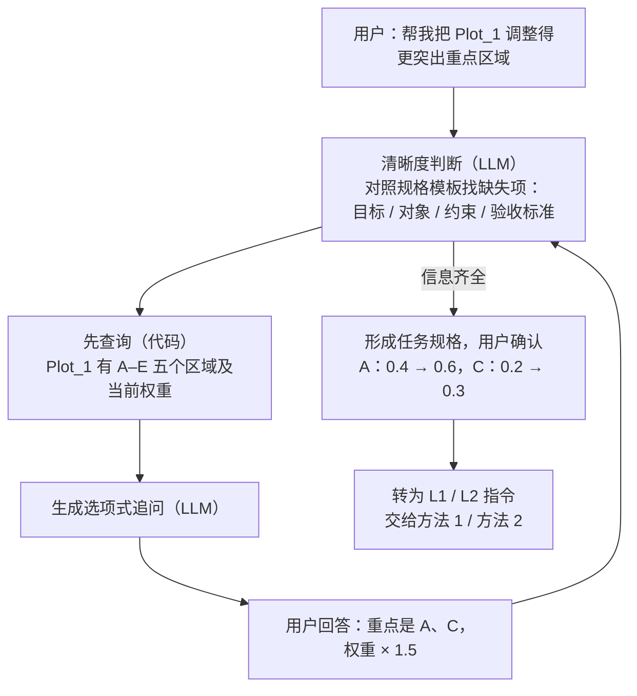
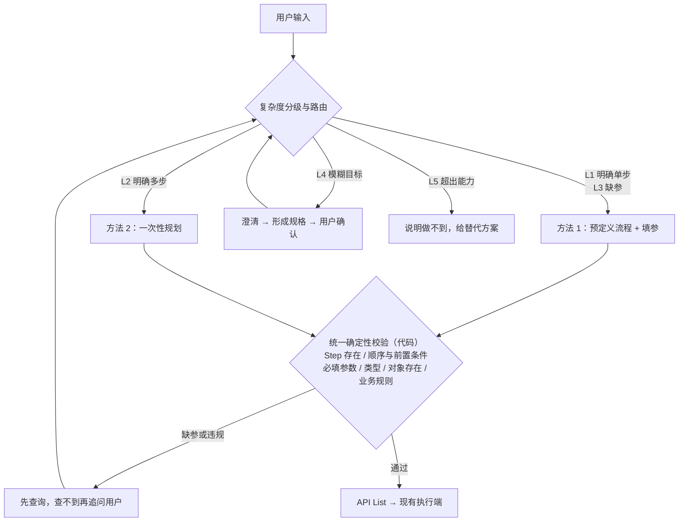

# NL 到可执行 Task：实现方法对比与选型建议

## 1. 要解决的问题

用户输入一句自然语言（NL），系统基于已有的 **Step 库**（业务步骤）和 **API 库**（可调用接口及参数），生成一份 **参数完整、顺序正确、可直接执行的 API List**；信息不足时向用户澄清。

本文统一使用以下三个示例：

| 编号 | 用户输入 | 特点 |
|---|---|---|
| 示例 1 | 把 A 区域的权重改为 0.8 | 单步，但漏了 `plot_name` |
| 示例 2 | 把 Plot_1 中 A、B、C 三个区域的权重都乘以 2 | 多步，后一步依赖前一步的查询结果 |
| 示例 3 | 帮我把 Plot_1 调整得更突出重点区域 | 模糊目标，没有明确步骤和数值 |

涉及的 API：

| API | 类型 | 参数 |
|---|---|---|
| `region_weight_query` | 查询（只读） | `plot_name`, `region_name` |
| `region_weight_change` | 修改 | `plot_name`, `region_name`, `weight` |

---

## 2. 三个关键问题

任何“NL 到可执行 Task”的方案，本质上都在回答三个问题：

| 关键问题 | 要回答什么 | 示例 2 的答案 |
|---|---|---|
| **① 拆步骤** | 这句话需要哪几个 Step？ | 查询权重 ×3、修改权重 ×3 |
| **② 定顺序** | 步骤之间谁先谁后？哪些可以并行？ | 先查询再修改；A、B、C 之间互不依赖，可以并行 |
| **③ 补参数** | 每个参数的值从哪里来？缺了怎么办？ | `plot_name`、`region_name` 来自原话；`weight` 来自“查询结果 × 2” |

另外有两个贯穿始终的环节，它们不属于三个问题本身，但决定了系统是否可靠：

- **前置：清晰度判断**。输入太模糊（示例 3）时，三个问题都无从回答，必须先澄清，不能直接规划。
- **后置：确定性校验**。LLM 给出的步骤、顺序、参数都可能出错，最终必须由代码按 API 库的定义统一校验。

下面先分别讲清楚每个关键问题有哪些做法，再看不同的整体方法如何组合这些做法。

---

## 3. 关键问题 ①：拆步骤

### 3.1 可选做法

| 做法 | 怎么做 | 适合 |
|---|---|---|
| **A. 匹配预设流程** | 每类操作由开发者预先写成固定流程。用向量检索或 LLM 分类，从流程库里选一个，步骤随流程一起确定 | 高频、固定的操作 |
| **B. 检索 + LLM 规划** | 先用向量检索从 Step 库召回 Top-K 个相关 Step，再让 LLM 从候选中挑选、组合成步骤列表 | Step 库大、需要临场组合 |
| **C. LLM 逐步决定** | 不事先拆，LLM 每执行完一步再决定下一步做什么 | 结果无法预知、需要边查边判断 |
| **D. LLM 写成程序** | LLM 写一段调用 API 函数的程序，步骤体现为程序中的函数调用 | 批量、循环、计算多 |

### 3.2 检索 Top-K 是怎么回事

当 Step 库很大时，不能每次把全部 Step 塞给 LLM（提示词过长、成本高、容易选错）。做法是：

1. **离线**：把每个 Step 的名称、描述、几句用户真实会说的话，转成向量存入索引。
2. **在线**：把用户的话也转成向量，计算与所有 Step 的相似度，取最相似的前 K 个。

   ```text
   用户：把 A 区域的权重改为 0.8
   相似度：region_weight_set 0.91 / region_weight_get 0.78 / region_color_set 0.65 ...
   取 Top-3 → 作为候选
   ```

3. **顺着 Step 找到 API**：根据每个候选 Step 关联的 API，从 API 库取出参数定义，供后续填参使用。
4. **分情况处理**：
   - 第一名明显领先 → 直接确定这个 Step，跳过 LLM 规划；
   - 几个候选分数接近 → 交给 LLM 选择，LLM 也拿不准就问用户；
   - 命中多个不同类型的 Step（如“查询”和“修改”） → 说明是多步任务，进入规划。

### 3.3 要点

- 示例说法的质量决定检索效果，每个 Step 应配几句真实用户说法，而不只是一个名字。
- 相似度阈值与 K 值要用真实数据调：阈值太低会误命中，太高会频繁反问。
- LLM 选出的 Step 必须在 Step 库中真实存在，由代码校验，不能接受 LLM 编造的 Step。

---

## 4. 关键问题 ②：定顺序

### 4.1 顺序从哪来：三类依赖

| 依赖类型 | 含义 | 示例 | 由谁决定最可靠 |
|---|---|---|---|
| **数据依赖** | 后一步的参数要用前一步的结果 | 修改 A 的权重，需要先查到 A 的当前权重 | LLM 在计划中显式标出引用（如 `$1`），代码据此排序 |
| **业务依赖** | 业务规则要求的先后，与数据无关 | 修改前必须先锁定图；新建区域后才能设置权重 | **写在 Step 库里**（前置条件），由代码强制，不交给 LLM 判断 |
| **无依赖** | 互不影响 | 查询 A、B、C 三个区域的权重 | 可以并行执行 |

### 4.2 可选做法

| 做法 | 怎么做 | 特点 |
|---|---|---|
| **A. 流程写死** | 顺序在预设流程里固定 | 最可靠，但无法应对新组合 |
| **B. 依赖图（DAG）** | LLM 输出每个步骤及其依赖，代码做拓扑排序；无依赖的步骤并行 | 顺序显式、可校验、可并行 |
| **C. 执行先后即顺序** | LLM 逐步决定，先做的就在前面 | 灵活，但顺序没有显式记录，无法事先检查 |
| **D. 程序语句顺序** | 由程序的语句先后、循环表达 | 循环天然支持，但需要读代码才能看懂 |

### 4.3 要点

- 业务依赖不要指望 LLM 记住。应在 Step 库中给每个 Step 声明“前置条件”，由代码检查计划是否满足，必要时自动补上前置步骤。
- 代码需要检查依赖图是否成环、引用的步骤是否存在。

---

## 5. 关键问题 ③：补参数

### 5.1 参数值的六个来源（按优先级）

| 优先级 | 来源 | 示例 | 由谁完成 |
|---|---|---|---|
| 1 | **用户原话** | “A 区域”“0.8” | LLM 抽取 |
| 2 | **对话上下文** | 上一轮刚说过“Plot_1”，这一轮省略了 | LLM 抽取 + 会话状态 |
| 3 | **前序步骤的结果** | 新权重 = 查询结果 × 2 | 计划中写引用，代码代入 |
| 4 | **查询 API 实时获取** | 当前权重、某个图下有哪些区域 | 代码调用只读 API |
| 5 | **业务默认值** | 未指定时默认作用于当前打开的图 | Step 库中声明，代码填入 |
| 6 | **追问用户** | 以上都拿不到时：“请问是哪个图？” | 代码判断缺失，生成追问 |

### 5.2 填参的四条原则

1. **LLM 只做“抽取”，不做“猜测”**。提示词中明确要求：原话里没有的参数必须填 `null`。
2. **缺参判断交给代码**。用 Pydantic 等按 API 库的定义校验必填项和类型，缺什么就问什么，不消耗 LLM。
3. **能查的先查，查不到再问**。例如用户只说“A 区域”，可以先查询哪些图里有 A 区域：只有一个就直接用，有多个就让用户选。
4. **追问给选项**。“请选择：Plot_1 / Plot_2”比“请问是哪个图？”收敛更快，也更容易转成参数值。

### 5.3 值的规范化与对象解析

用户说的不一定是 API 能直接用的值，代码需要做转换和检查：

- 数值：“零点八”“百分之八十” → `0.8`，并检查取值范围；
- 对象：“A 区”“A 区域” → 对应的 `region_name` 或 ID，并通过查询 API 确认它真实存在；
- 模糊值：“调高一点”无法直接转换，应给出默认幅度（如 +10%）并请用户确认。

### 5.4 示例 1 的完整填参过程

```text
用户：把 A 区域的权重改为 0.8

LLM 抽取：  {"plot_name": null, "region_name": "A", "weight": 0.8}
代码校验：  plot_name 缺失
先查：      查询包含 A 区域的图 → Plot_1、Plot_3
追问：      "A 区域存在于 Plot_1 和 Plot_3，请选择要修改哪一个"
用户：      Plot_1
再次校验：  通过
输出：      [{"action": "region_weight_change",
              "params": {"plot_name": "Plot_1", "region_name": "A", "weight": 0.8}}]
```

---

## 6. 四种整体实现方法

把上面三个问题的不同做法组合起来，就形成了几种整体方法。**区分方法的标准是：执行步骤由谁决定、计划以什么形式表达、全部步骤在什么时候确定**。这三点相同，就是同一种方法，不论它叫什么项目、用什么框架。

### 6.1 一张表看懂区别

| | 方法 1：预定义流程 | 方法 2：一次性规划 | 方法 3：边执行边决策 | 方法 4：代码即计划 |
|---|---|---|---|---|
| **一句话** | 人写流程，LLM 只填参数 | LLM 先写完整计划，程序照着执行 | LLM 走一步看一步 | LLM 写程序 |
| **① 拆步骤** | 人预先写好，LLM 只负责选流程 | LLM 一次性列出全部步骤 | LLM 每次只决定下一步 | LLM 写成程序里的函数调用 |
| **② 定顺序** | 写死在流程里 | 计划中显式标出依赖，代码排序，可并行 | 执行的先后就是顺序，事先没有记录 | 程序语句的先后和循环 |
| **③ 补参数** | LLM 从原话抽取，缺了追问 | 已知值直接填，未知值用 `$1` 引用前序结果 | LLM 看到上一步真实结果后再填 | 程序变量传递；查询函数取值 |
| 计划的形式 | 预先写好的流程 | 步骤清单（JSON / 依赖图） | 没有完整计划 | 一段 Python 程序 |
| 全部步骤何时确定 | 设计时 | 执行前一次性 | 执行过程中逐步 | 执行前一次性 |
| 示例 2 的 LLM 调用 | 1～2 次 | 1 次（失败再规划） | 约 7 次 | 1 次（报错再改） |
| 能处理没预设过的组合 | 不能 | 能 | 能 | 能 |
| 执行前能否审核完整计划 | 能（流程固定） | 能 | 不能 | 能，但要读代码 |
| 可控性 | 最高 | 较高 | 最低 | 较低 |

### 6.2 同一句话，四种方法的 LLM 输出

输入均为示例 2：“把 Plot_1 中 A、B、C 三个区域的权重都乘以 2”。

**方法 1：输出“选中的流程 + 参数”**

```text
流程: scale_region_weights          # 开发者预先写好的“批量缩放权重”流程
参数: {"plot_name": "Plot_1", "region_names": ["A", "B", "C"], "factor": 2}

# 查询、乘法、循环都写在流程代码里，LLM 不参与
# 如果没有预先写这个流程 → 无法处理
```

**方法 2：输出完整的步骤清单**

```text
1. region_weight_query("Plot_1", "A")
2. region_weight_query("Plot_1", "B")
3. region_weight_query("Plot_1", "C")
4. region_weight_change("Plot_1", "A", $1 * 2)
5. region_weight_change("Plot_1", "B", $2 * 2)
6. region_weight_change("Plot_1", "C", $3 * 2)

# 规划时还不知道 A 的权重，只能用 $1 占位
# 1–3 互不依赖可并行；4 依赖 1，5 依赖 2，6 依赖 3
```

**方法 3：每次只输出下一步动作**

```text
第 1 轮  LLM: 调用 region_weight_query("Plot_1", "A")     → 结果 0.4
第 2 轮  LLM: 记录 region_weight_change("Plot_1", "A", 0.8)
第 3 轮  LLM: 调用 region_weight_query("Plot_1", "B")     → 结果 0.3
...
第 7 轮  LLM: 全部完成

# LLM 能看到真实的 0.4，乘法由 LLM 自己算（可能算错）
```

**方法 4：输出一段程序**

```python
for region in ["A", "B", "C"]:
    w = region_weight_query("Plot_1", region)
    add_weight_change("Plot_1", region, w * 2)   # 只记录到 API List，不真正修改
```

```text
# 区域从 3 个变成 300 个，代码长度不变；乘法由代码完成，结果准确
```

### 6.3 方法 1：预定义流程 + 槽位填充



- **核心**：LLM 只做“选择”和“填空”，步骤和顺序完全由人决定。
- **优点**：最可控、可逐条测试；LLM 调用最少，延迟和成本最低；不会编造步骤。
- **缺点**：只能处理预先设计过的操作；流程多了以后维护成本高。
- **适合**：高频、固定的操作。

### 6.4 方法 2：一次性规划（计划即数据）



- **核心**：计划是一份结构化数据，执行前就完整存在。
- **优点**：能组合新的多步任务；计划可校验、可让用户确认；可并行；LLM 调用少。
- **缺点**：规划时看不到中间结果，只能占位；循环和计算要专门设计（如提供计算函数）；计划错了需重新规划。
- **适合**：多步组合，且希望执行前能审核。

### 6.5 方法 3：边执行边决策（ReAct 循环）



- **核心**：没有事先的完整计划，每一步都由 LLM 根据最新结果决定。这是目前各家大模型 function calling 的默认用法。
- **优点**：最灵活，能根据中间结果调整；实现最简单，主流框架都内置。
- **缺点**：LLM 调用次数多，延迟和成本最高；执行前看不到完整计划，难以审核；行为不稳定，可能绕路、重复或提前结束。
- **适合**：结果无法预知、需要边查边判断的探索型任务；与用户的澄清对话。

### 6.6 方法 4：代码即计划（CodeAct）



- **核心**：程序本身就是计划，循环、条件、计算都由代码表达。
- **关键机制**：修改类函数不真正修改数据，只往列表里追加一条调用记录；程序跑完后，这个列表就是 API List。
- **优点**：表达力最强；批量操作时计划长度不随数量增长；计算准确。
- **缺点**：必须有沙箱和安全审查，工程成本最高；业务人员难以审核；同一句话可能生成不同代码。
- **适合**：批量、循环、计算类操作占比高。

### 6.7 补充：专用模型与约束输出（可叠加的组件）

这不是第五种方法，而是替换上述方法中 LLM 节点的“零件”：

- **专用工具调用模型**：经过专门训练，选 API、填参数更准，小模型可私有化部署（如 Gorilla、xLAM、ToolACE）。
- **约束输出**：保证 LLM 输出的 JSON 格式一定合法（如 Outlines 约束解码，Instructor 校验失败自动重试）。

注意：**格式合法不等于内容正确**。缺参、编造参数仍需业务校验拦截。

---

## 7. 输入复杂度：不同输入适合不同方法

用户输入从明确指令到“帮我实现一个……”都有。复杂度不同，三个关键问题的难点也不同：

| 级别 | 示例 | ① 拆步骤 | ② 定顺序 | ③ 补参数 | 推荐方法 |
|---|---|---|---|---|---|
| L1 明确单步 | 把 Plot_1 的 A 区域权重改为 0.8 | 简单 | 不涉及 | 简单 | 方法 1 |
| L2 明确多步 | 示例 2 | 需要组合 | 有数据依赖 | 需引用前序结果 | 方法 2；批量计算多时用方法 4 |
| L3 不完整 / 有歧义 | 把 A 的权重调高一点 | 简单 | 简单 | **难**：缺参、值模糊 | 方法 1 的追问机制 |
| L4 模糊目标 | 示例 3 | **难**：不知道要做什么 | 无从谈起 | 无从谈起 | 先澄清形成规格，再转为 L1 / L2 |
| L5 超出能力 | 帮我做一个自动推荐权重的算法 | API 库组合不出来 | — | — | 明确告知做不到，给替代方案 |

### 7.1 模糊目标（L4）的处理

模糊目标的难点不在“生成”，而在“问清楚”。处理流程：



原则：

- **不在模糊输入上直接规划**：信息不够就不输出 API List，避免“猜”出错误操作。
- **先查后问**：能用只读 API 查到的信息不问用户。
- **给选项**：“a. 权重 × 1.5 / b. 设为指定值 / c. 降低其他区域”，比开放式提问更快收敛。
- **先写规格再分解**：把需求整理成结构化规格并经用户确认后，再拆成步骤。
- **常见目标预置模板**：命中模板直接复用，比让 LLM 自由规划稳定得多。

---

## 8. 推荐方案：按复杂度组合方法

### 8.1 整体架构



### 8.2 三个关键问题在推荐方案中的解法

| 关键问题 | 解法 |
|---|---|
| ① 拆步骤 | 向量检索 Top-K 缩小候选；明确单步直接命中预设流程；多步由 LLM 从候选中组合；模糊目标先澄清再拆 |
| ② 定顺序 | 数据依赖由 LLM 在计划中用 `$n` 显式标出；业务依赖写在 Step 库的前置条件里，由代码强制；代码做拓扑排序，无依赖步骤并行 |
| ③ 补参数 | 按“原话 → 上下文 → 前序结果 → 查询 API → 默认值 → 追问”的优先级补全；LLM 只抽取不猜测；缺参判断与值校验全部由代码完成 |

### 8.3 为什么这样选

- **方法 1 处理高频固定操作**：实际业务中这类指令通常占多数，用最可控、最便宜的方法。
- **方法 2 处理多步组合**：计划可审核、可让用户确认。不选方法 3 作为主力，是因为它调用次数多、执行前无法审核。
- **方法 4 暂不引入**：安全治理成本高，只有当批量、计算类指令占比明显高时再评估。
- **专用模型按需替换**：有私有化、成本或延迟要求时替换 LLM 节点，架构不变。
- **统一校验兜底**：所有 LLM 输出都经过同一套确定性校验，这是防止编造步骤和参数的关键。

### 8.4 实施顺序

| 阶段 | 内容 |
|---|---|
| P0 | 收集真实用户输入，按 L1–L5 标注占比；建立评测集（输入 → 期望 API List 或期望追问） |
| P1 | 复杂度分级 + 方法 1（L1、L3）+ 统一校验 |
| P2 | 方法 2（L2），包括依赖图、`$n` 引用、计划确认 |
| P3 | L4 澄清与规格化、任务模板库；L5 能力边界答复 |
| P4 | 根据评测结果决定是否引入方法 4 或专用模型 |

### 8.5 主要风险

| 风险 | 应对 |
|---|---|
| 复杂度误判：模糊目标被当成明确指令乱执行，或明确指令被过度追问 | 分级器单独评测；拿不准时宁可走澄清 |
| LLM 编造参数 | 要求未提及填 `null`；代码校验兜底 |
| 业务顺序错误 | 前置条件写进 Step 库，由代码强制 |
| 追问过多影响体验 | 先查后问、给选项、一次合并多个问题 |
| 查询类调用在生成阶段已真实执行 | 确保它们只读、无副作用 |

---

## 9. 开源参考实现

以下项目按所采用的方法归类。同一方法下的项目只是细节不同（产品形态、是否并行、是否重新规划等）。数据截至 2026-11-13，来源为各 GitHub 仓库。

| 方法 | 项目 | 说明 | 许可 / 状态 |
|---|---|---|---|
| 方法 1 | Rasa CALM | 对话引擎，缺参追问、改口、取消、意图澄清都内置 | 商业产品（Rasa Pro）；开源版 `rasa` 已进入维护模式 |
| 方法 1 | Dify | 可视化平台，有“问题分类器”和“参数提取器”节点 | 开源，约 161k stars |
| 方法 1 | Semantic Router | 意图路由组件，用向量匹配选择流程 | MIT，约 4k stars，活跃 |
| 方法 2 | LLMCompiler | 计划是依赖图，并行执行，失败可重新规划 | MIT，约 1.9k stars，2024 年后停更 |
| 方法 2 | ReWOO | 一次规划、顺序执行，最省 token | MIT，约 0.9k stars，2023 年后停更 |
| 方法 2 | HuggingGPT | 任务 JSON（id / 依赖 / 参数），用于调度 AI 模型；同仓库的 TaskBench 可借鉴做评测 | MIT，约 25.6k stars，研究项目 |
| 方法 3 | ReAct | 提出该方法的论文代码 | MIT，约 4.3k stars，研究原型 |
| 方法 4 | smolagents | 轻量代码 Agent，可嵌入现有系统 | Apache-2.0，约 30k stars，活跃 |
| 方法 4 | TaskWeaver | 规划 + 有状态代码执行，插件对应 API | MIT，已归档 |
| 组件 | Gorilla / xLAM / ToolACE | 专用工具调用模型；Gorilla 提供 BFCL 函数调用评测 | Apache-2.0 等，活跃 |
| 组件 | Outlines / Instructor | 约束输出 / 校验重试 | Apache-2.0 / MIT，活跃 |
| 模糊目标 | MetaGPT | 一句话需求逐级细化为规格和任务 | MIT，约 71k stars |
| 模糊目标 | Ask-before-Plan | 先判断是否需要提问，能查的先查（EMNLP 2024） | MIT，研究代码 |
| 实现框架 | LangGraph | 编排框架，可实现以上任一方法；支持暂停等待用户输入 | MIT，约 45k stars，活跃 |

说明：

- 没有一个开源项目可以直接满足需求。它们要么是封闭产品，要么是已停更的研究原型，要么只是组件。建议**借鉴方法、自建系统**。
- LangGraph、Dify 是**实现工具**，不是方法。用它们可以实现上面任何一种方法，框架选型是另一个层面的决定。

---

## 10. 汇报要点

1. **问题本质**：NL 到可执行 Task 需要解决三个问题：拆出哪些步骤、步骤间的顺序、参数值如何补全。此外，前面要判断输入是否足够清晰，后面要做统一校验。
2. **方法区别**：主流实现方法有四种，根本区别在于“步骤由谁决定、以什么形式表达、何时确定”：
   - 人写流程，LLM 只填参数；
   - LLM 先写完整计划再执行；
   - LLM 边执行边决定下一步；
   - LLM 直接写程序。
3. **选型建议**：按输入复杂度组合使用：
   - 高频固定操作用预定义流程；
   - 多步组合用一次性规划；
   - 模糊目标先澄清再转为前两者。
4. **可靠性保障**：LLM 只负责理解和提议；顺序约束、参数校验、缺参判断都由代码完成。
5. **落地路径**：先收集真实输入，建立分层评测集，再从高频单步指令开始逐步扩展。
